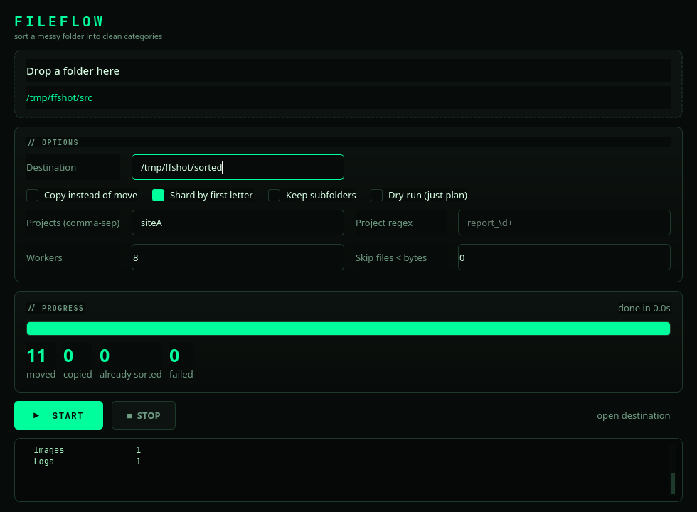

# FileFlow

Sort a messy folder into clean, categorized folders — **library + CLI + Qt GUI**.
Drop a folder on the window, press Start, watch it sort. Everything stays local.



## What it does

- **Categorises** by extension and name hints: Documents, Images, Videos, Audio,
  Archives, Code, Data, Fonts, Executables, Logs, Other.
- **Projects** — pull your own projects out by name or regex into `Projects/<name>/`.
- **Sharding** — split big categories into `A/`, `B/`, `C/` so no folder ends up
  with a million files.
- **Keep subfolders** — `sub/deep/file.pdf` stays under `Documents/sub/deep/`.
- **Group by date** — `Documents/2025/06/report.pdf`.
- **Duplicates** — hash-compare and move extra copies to `Duplicates/`
  (or only report them).
- **Exclude globs** — skip `*.tmp`, `node_modules`, `.git`, whatever you like.
- **Prune empty folders** left behind after a run.

## Safety

| Guarantee | Why it matters |
|---|---|
| **Nothing is overwritten** | destinations are allocated under a lock; a collision becomes `name_ab12cd34.pdf` |
| **Second run is a no-op** | files already at their destination count as "already sorted" |
| **Stop really stops** | checked before queueing and inside every task; in-flight work is still counted so stats match the disk |
| **Undo** | every run writes a journal; one button puts everything back (and removes copies), never overwriting newer files |
| **No shell** | argv only, nothing is passed through a shell |
| **Own output is not re-scanned** | a destination inside the source is skipped |

## Install

```bash
git clone https://github.com/ilievi187/fileflow.git
cd fileflow
```

- Python 3.11+ (uses standard-library `tomllib`)
- GUI only: `pyside6` (`sudo pacman -S pyside6`)

Register the app launcher entry:

```bash
./install.sh
```

## GUI

```bash
./run.sh            # or: python3 fileflow_qt.py
```

- drag a folder anywhere on the window, or click the box
- destination optional — empty means sort in place
- live progress bar and counters: moved / copied / already sorted / duplicates / failed
- **Undo last run** restores the previous run from its journal
- Stop, `Ctrl+Enter` to start, `Esc` to stop
- "open destination" when it finishes
- **follows the desktop theme** (Omarchy): colours reload live when you switch
  themes, everything else stays put
- quiet motion: faded page load, smooth progress and counters, gentle glow while
  a run is active

`fileflow.desktop` + `icons/fileflow.svg` are included for the app launcher.

## CLI

```bash
# preview only
python3 file_organizer.py ~/Downloads --dry-run

# sort into a separate tree, pull out projects, skip junk
python3 file_organizer.py ~/messy --dest ~/sorted \
    --projects siteA,projectX --exclude '*.tmp,node_modules,.git'

# move duplicate copies aside, group by date, prune empty folders
python3 file_organizer.py ~/messy --dest ~/sorted \
    --duplicates move --by-date --prune-empty

# undo the last run
python3 file_organizer.py --undo
```

| Flag | Meaning |
|---|---|
| `--dest DIR` | destination (default: in place) |
| `--copy` | copy instead of move |
| `--dry-run` | plan only |
| `--no-shard` | one folder per category |
| `--keep-tree` | keep source subfolders inside each category |
| `--by-date` | group inside each category by `YYYY/MM` |
| `--prune-empty` | remove folders left empty |
| `--projects a,b` | project names to pull into `Projects/` |
| `--project-regex RE` | regex alternative |
| `--exclude GLOBS` | comma-separated globs to ignore |
| `--duplicates keep\|move\|report` | what to do with identical files |
| `--min-size-bytes N` | skip small files |
| `--max-workers N` | worker threads (default 8) |
| `--journal PATH` | where to record the run (default: user state dir) |
| `--no-journal` | no journal — disables undo |
| `--undo` | reverse the recorded run |
| `--log FILE` | JSONL per-file log |
| `--json-out FILE` | stats JSON |

## Library

```python
from file_organizer import organize, undo

stats = organize(
    "~/messy",
    dest="~/sorted",
    exclude="*.tmp,node_modules",
    duplicates="move",
    by_date=True,
    prune_empty=True,
    on_event=print,                        # progress text
    on_progress=lambda done, total: ...,   # progress bar
)
print(stats["moved"], stats["duplicates"])

undo("~/.local/state/fileflow/last-run.jsonl")
```

`stop_event=threading.Event()` cancels either call.

## Tests

The [GitHub Actions CI workflow](.github/workflows/ci.yml) runs the organizer tests on Python 3.11, 3.12 and 3.13, plus a headless Qt smoke test on Linux. You can run the same checks locally:


```bash
python3 -m unittest discover -s tests -v
```

25 tests: collisions (including 25 identical names), idempotency, project moves,
keep-tree stability, stop before/while running, dry-run, min-size, per-file logs,
logs classification, undo (restore / copy removal / no overwrite / dry-run),
exclusions, date grouping, pruning and duplicate detection.

Headless GUI check:

```bash
QT_QPA_PLATFORM=offscreen python3 fileflow_qt.py --smoke
```

## Layout

```
file_organizer.py    # library + CLI (classify, plan, allocate, run, undo)
fileflow_qt.py       # PySide6 GUI
ui_theme.py          # Omarchy theme reader -> palette + QSS
tests/               # unittest suite
run.sh               # GUI launcher
install.sh           # writes the launcher entry with the right absolute path
fileflow.desktop     # app launcher entry (template)
icons/fileflow.svg
```

## Notes

- Moves use `shutil.move`; cross-device moves fall back to copy+delete.
- Symlinks are moved/copied as links, never followed.
- The journal is overwritten by each run, so Undo always refers to the last one.

## Licence

MIT — see [LICENSE](LICENSE).
